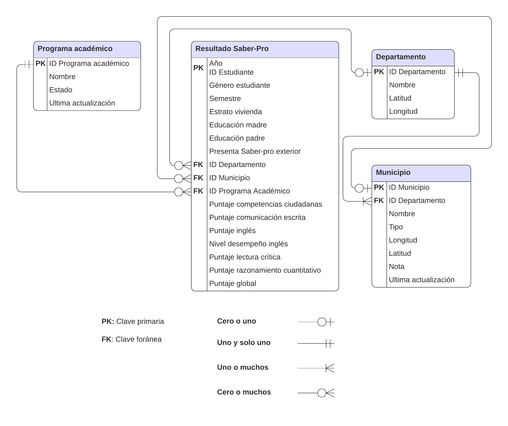

```{r}
#| label: load-packages
#| message: false
library(tidyverse)
library(readxl)
library(janitor)
library(scales)
```

# Preliminares

## {.smaller .center}

::: {.incremental}
- Verificar: 

  - ¿La carpeta `data` fue creada?
  - ¿El archivo `serie-nacional-de-poblacion_area-sexo-edad_2018-2070_2025-07-18.xlsx` fue incluído en `data`?

- Instalar paquetes:

  - `install.packages("janitor")` 

- Generar carpetas:

  - `016_datos-ordenados-en-r`

    - Crear archivo `001_datos-ordenados.R`

  - `017_pivotear-datos-en-r`

    - Crear archivo `001_pivotear.R`
:::

# Datos ordenados

## {.smaller .center}

:::: {.columns}

::: {.column width="60%"}
- El concepto de **datos ordenados** (en inglés **tidy data**), propuesto por Hadley Wickham [@wickham_tidy_2014], proporciona un marco para vincular:

  - La **estructura** de un conjunto de datos (su disposición en filas y columnas) con su **semántica** (su significado real).

::: {.incremental}
- Este estándar permite:

  - Simplificar las etapas iniciales de limpieza.
  - Facilitar la exploración y modelado de datos.
  - Asegurar que los paquetes del `tidyverse` interactúen sin fricciones.
:::
:::

::: {.column width="40%"}
{#fig-hadley-wickham height="370px"}
:::

::::

## Estructura de datos {.smaller .center}

::: {.incremental}
- Gran parte de los conjuntos de datos se organizan en **tablas rectangulares** compuestas por **filas** y **columnas**.
- En la práctica, las columnas casi siempre se identifican mediante encabezados y las filas en ocasiones cuentan con etiquetas [@wickham_tidy_2014].
- Sin embargo, una misma información puede presentarse en disposiciones físicas muy diferentes.
- Consideremos un experimento médico hipotético analizado en [@wickham_tidy_2014], donde se evalúa el resultado de 2 tratamientos (**a** y **b**) en 3 individuos (**John Smith**, **Jane Doe** y **Mary Johnson**).
:::

## Estructura de datos {.smaller .center}

### Tabla de presentación vs. Tabla transpuesta

:::: {.columns}

::: {.column width="50%"}
**Tabla de presentación**

| individuo | **a** | **b** |
| :--- | :---: | :---: |
| John Smith | NA | 2 |
| Jane Doe | 16 | 11 |
| Mary Johnson | 3 | 1 |

: Filas y columnas etiquetadas {#tbl-presentacion}
:::

::: {.column width="50%"}
**Tabla transpuesta**

| tratamiento | John Smith | Jane Doe | Mary Johnson |
| :--- | :---: | :---: | :---: |
| **a** | NA | 16 | 3 |
| **b** | 2 | 11 | 1 |

: Filas y columnas transpuestas {#tbl-transpuesta}
:::

::::

::: {.fragment}
Ambas tablas transmiten **exactamente la misma información**, pero su disposición física y espacial es totalmente distinta. Por tanto, el vocabulario habitual de "filas" y "columnas" es insuficiente: se requiere examinar la **semántica** de los datos [@wickham_tidy_2014].
:::

## Semántica de datos {.smaller .center}

::: {.incremental}
- Un conjunto de datos es una colección de **valores** (*values*), usualmente números o cadenas de texto [@wickham_tidy_2014].
- En la semántica de datos, todo valor pertenece simultáneamente a 2 conceptos fundamentales:

  1. **Variable**: contiene todos los valores que miden un mismo atributo o característica (como la estatura, la temperatura o el resultado de una prueba) a través de distintas unidades de análisis.
  2. **Observación**: contiene todos los valores medidos sobre una misma unidad de análisis (como una persona, un día específico o una muestra médica) a través de diferentes atributos.
  3. **Valor**: corresponde a la medición individual de un atributo específico registrada en una celda.
:::

## Semántica de datos {.smaller .center}

### Estructura vinculada a la semántica

:::: {.columns}

::: {.column width="45%"}
| individuo | tratamiento | resultado |
| :--- | :---: | :---: |
| John Smith | a | NA |
| Jane Doe | a | 16 |
| Mary Johnson | a | 3 |
| John Smith | b | 2 |
| Jane Doe | b | 11 |
| Mary Johnson | b | 1 |

: Variables en columnas y observaciones en filas {#tbl-datos-ordenados}
:::

::: {.column width="55%"}
::: {.incremental}
- Se hacen explícitos los **18 valores** correspondientes a **3 variables** y **6 observaciones**:
  - **`individuo`**: 3 valores posibles (`John Smith`, `Jane Doe`, `Mary Johnson`).
  - **`tratamiento`**: 2 valores posibles (`a` y `b`).
  - **`resultado`**: mediciones cuantitativas y valor ausente (`NA`, `16`, `3`, `2`, `11`, `1`).
:::
:::

::::

## Semántica de datos {.smaller .center}

### Gestión de valores ausentes

El diseño del estudio define la estructura de las observaciones y cómo deben gestionarse los valores ausentes:

::: {.incremental}
- **Valores ausentes estructurales**:
  - Representan mediciones que **no pueden ocurrir** por la propia naturaleza del fenómeno (por ejemplo, el número de partos en individuos masculinos).
  - Estos registros pueden descartarse sin pérdida de rigor.

- **Valores ausentes explícitos**:
  - Representan observaciones que **debieron haberse registrado**, pero por alguna circunstancia se omitieron o no se obtuvieron (como el tratamiento `a` en `John Smith`).
  - Es fundamental conservarlos explícitamente como valores ausentes (`NA` en R).
:::

## Características de datos ordenados {.smaller .center}

De acuerdo con Wickham [@wickham_tidy_2014; @wickham_r_2023], un conjunto de datos es **ordenado** si satisface 4 reglas fundamentales:

::: {.incremental}
1. **Cada variable forma una columna**.
2. **Cada observación forma una fila**.
3. **Cada valor es una celda**.
4. **Cada tipo de unidad observacional forma una tabla**.
:::

::: {.fragment}
> Cualquier disposición física que no cumpla con estas reglas se clasifica como **datos no ordenados** (en inglés **non-tidy data**).
:::

# Problemas más comunes con datos no ordenados

## Problemas habituales {.smaller .center}

En la práctica, los datos suelen encontrarse en formatos no ordenados. La gran mayoría de las dificultades estructurales se reducen a **5 problemas habituales** [@wickham_tidy_2014]:

::: {.incremental}
1. Nombres de columnas que representan **valores y no nombres de variables**.
2. **Múltiples variables** combinadas en una sola columna.
3. Variables distribuidas simultáneamente en **filas y en columnas**.
4. Múltiples **unidades observacionales** mezcladas en una sola tabla.
5. Una misma unidad observacional fragmentada en **múltiples tablas o archivos**.
:::

## Nombres de columnas que son valores, no variables {.smaller .center}

::: {.incremental}
- Ocurre frecuentemente en tablas para reportes donde los encabezados corresponden a niveles o categorías de una variable.
- Para reestructurar estas tablas se utiliza la función `pivot_longer()` del paquete `tidyr`.
- Transforma múltiples columnas en un par de columnas `nombre`-`valor` (*name*-*value*), aumentando filas y reduciendo columnas.
:::

## Nombres de columnas que son valores, no variables {.smaller .center}

### Ejemplo 1: `relig_income`

- Los encabezados (`<$10k`, `$10-20k`, ... , `Don't know/refused`) representan valores de la variable `ingreso`.

:::: {.columns}

::: {.column width="48%"}
```{r}
#| eval: false
#| echo: true
#| code-line-numbers: "|1-2|4-10|7|8|9|"
# Cargar paquetes ----
library(tidyverse)

# Pivotear a formato largo ----
relig_income |>
  pivot_longer(
    cols = `<$10k`:`Don't know/refused`,
    names_to = "ingreso",
    values_to = "frecuencia"
  )
```
:::

::: {.column width="52%"}
::: {style="font-size: 70%;"}
```{r}
relig_income |>
  pivot_longer(
    cols = `<$10k`:`Don't know/refused`,
    names_to = "ingreso",
    values_to = "frecuencia"
  )
```
:::
:::

::::

## Nombres de columnas que son valores, no variables {.smaller .center}

### Ejemplo 2: `billboard`

- Las columnas `wk1` a `wk76` corresponden a semanas del ranking: son valores de una única variable (`semana`).

:::: {.columns}

::: {.column width="48%"}
```{r}
#| eval: false
#| echo: true
#| code-line-numbers: "|4-6|7|"
# Pivotear a formato largo ----
billboard |>
  pivot_longer(
    cols = wk1:wk76,
    names_to = "semana",
    values_to = "posicion",
    values_drop_na = TRUE
  )
```
:::

::: {.column width="52%"}
::: {style="font-size: 70%;"}
```{r}
billboard |>
  pivot_longer(
    cols = wk1:wk76,
    names_to = "semana",
    values_to = "posicion",
    values_drop_na = TRUE
  )
```
:::
:::

::::

## Múltiples variables en una sola columna {.smaller .center}

::: {.incremental}
- Surge cuando los encabezados unen 2 o más variables dentro de una sola etiqueta compuesta.
- Ejemplo: conjunto de datos de tuberculosis (`tb`), donde columnas como `m_014` agrupan:
  - **Sexo**: `m` (masculino) y `f` (femenino).
  - **Rango de edad**: `014` (0 a 14 años) y `1524` (15 a 24 años).
- Para ordenar:
  1. `pivot_longer()` para agrupar las columnas compuestas en una columna intermedia `demo`.
  2. `separate_wider_delim()` para dividir `demo` en `sexo` y `edad`.
:::

## Múltiples variables en una sola columna {.smaller .center}

### Construcción con `tribble()`

::: {.incremental}
- La función `tribble()` del paquete `tibble` permite definir tablas fila por fila para ejemplos o demostraciones:
  - Los nombres de columna inician con virgulilla (`~`).
  - Los valores se ingresan a lo largo de las filas separados por comas.
:::

:::: {.columns}

::: {.column width="56%"}
```{r}
#| eval: false
#| echo: true
#| code-line-numbers: "|1-7|9|"
# Crear muestra de datos ----
tb_muestra <- tribble(
  ~iso2 , ~year , ~m_014 , ~m_1524 , ~f_014 , ~f_1524 ,
  "AD"  ,  2000 ,      0 ,       0 ,      1 ,       1 ,
  "AE"  ,  2000 ,      2 ,       4 ,      3 ,       4 ,
  "AF"  ,  2000 ,     52 ,     228 ,     93 ,     140
)

tb_muestra
```
:::

::: {.column width="44%"}
::: {style="font-size: 70%;"}
```{r}
tb_muestra <- tribble(
  ~iso2 , ~year , ~m_014 , ~m_1524 , ~f_014 , ~f_1524 ,
  "AD"  ,  2000 ,      0 ,       0 ,      1 ,       1 ,
  "AE"  ,  2000 ,      2 ,       4 ,      3 ,       4 ,
  "AF"  ,  2000 ,     52 ,     228 ,     93 ,     140
)

tb_muestra
```
:::
:::

::::

## Múltiples variables en una sola columna {.smaller .center}

### Reestructurar y separar variables

:::: {.columns}

::: {.column width="48%"}
```{r}
#| eval: false
#| echo: true
#| code-line-numbers: "|1-7|8-12|9|10|11|"
# Pivotear y separar variables ----
tb_muestra |>
  pivot_longer(
    cols = `m_014`:`f_1524`,
    names_to = "demo",
    values_to = "casos"
  ) |>
  separate_wider_delim(
    cols = demo,
    delim = "_",
    names = c("sexo", "edad")
  )
```
:::

::: {.column width="52%"}
::: {style="font-size: 70%;"}
```{r}
tb_muestra |>
  pivot_longer(
    cols = `m_014`:`f_1524`,
    names_to = "demo",
    values_to = "casos"
  ) |>
  separate_wider_delim(
    cols = demo,
    delim = "_",
    names = c("sexo", "edad")
  )
```
:::
:::

::::

## Variables almacenadas en filas y columnas {.smaller .center}

::: {.incremental}
- Es la forma más compleja: ciertas variables están distribuidas a lo largo de las columnas, mientras otras variables tienen sus nombres almacenados como valores dentro de filas.
- Ejemplo: registros meteorológicos diarios de la estación MX17004 (2010):
  - Los días del mes se encuentran dispersos en columnas (`1`, `2`, `3`).
  - La columna `element` almacena nombres de variables (`tmax` y `tmin`) como valores de fila.
- Para ordenarlos se combinan `pivot_longer()` y `pivot_wider()`.
:::

## Variables almacenadas en filas y columnas {.smaller .center}

### Muestra de datos meteorológicos

:::: {.columns}

::: {.column width="58%"}
```{r}
#| eval: false
#| echo: true
#| code-line-numbers: "|1-10|12|"
# Crear muestra de clima ----
clima_muestra <- tribble(
  ~id       , ~ano , ~mes , ~element , ~`1` , ~`2` , ~`3` ,
  "MX17004" , 2010 ,    1 , "tmax"   , NA   , NA   , NA   ,
  "MX17004" , 2010 ,    1 , "tmin"   , NA   , NA   , NA   ,
  "MX17004" , 2010 ,    2 , "tmax"   , NA   , 27.3 , 24.1 ,
  "MX17004" , 2010 ,    2 , "tmin"   , NA   , 14.4 , 14.4 ,
  "MX17004" , 2010 ,    3 , "tmax"   , NA   , NA   , NA   ,
  "MX17004" , 2010 ,    3 , "tmin"   , NA   , NA   , NA
)

clima_muestra
```
:::

::: {.column width="42%"}
::: {style="font-size: 70%;"}
```{r}
clima_muestra <- tribble(
  ~id       , ~ano , ~mes , ~element , ~`1` , ~`2` , ~`3` ,
  "MX17004" , 2010 ,    1 , "tmax"   , NA   , NA   , NA   ,
  "MX17004" , 2010 ,    1 , "tmin"   , NA   , NA   , NA   ,
  "MX17004" , 2010 ,    2 , "tmax"   , NA   , 27.3 , 24.1 ,
  "MX17004" , 2010 ,    2 , "tmin"   , NA   , 14.4 , 14.4 ,
  "MX17004" , 2010 ,    3 , "tmax"   , NA   , NA   , NA   ,
  "MX17004" , 2010 ,    3 , "tmin"   , NA   , NA   , NA
)

clima_muestra
```
:::
:::

::::

## Variables almacenadas en filas y columnas {.smaller .center}

### Combinación `pivot_longer()` y `pivot_wider()`

:::: {.columns}

::: {.column width="48%"}
```{r}
#| eval: false
#| echo: true
#| code-line-numbers: "|1-8|9|10-13|11|12|"
# Colapsar días y pivotear variables ----
clima_muestra |>
  pivot_longer(
    cols = `1`:`3`,
    names_to = "dia",
    values_to = "valor",
    values_drop_na = TRUE
  ) |>
  mutate(dia = as.integer(dia)) |>
  pivot_wider(
    names_from = element,
    values_from = valor
  )
```
:::

::: {.column width="52%"}
::: {style="font-size: 70%;"}
```{r}
clima_muestra |>
  pivot_longer(
    cols = `1`:`3`,
    names_to = "dia",
    values_to = "valor",
    values_drop_na = TRUE
  ) |>
  mutate(dia = as.integer(dia)) |>
  pivot_wider(
    names_from = element,
    values_from = valor
  )
```
:::
:::

::::

## Diferentes unidades observacionales en una sola tabla {.smaller .center}

::: {.incremental}
- Ocurre cuando un conjunto de datos recopila información de diferentes unidades observacionales dentro de una misma tabla.
- **Consecuencias**:
  - Duplicación redundante de registros y aumento innecesario del tamaño.
  - Riesgo elevado de inconsistencias al actualizar información.
- **Solución relacional** (modelo Saber-Pro):
  - Estructurar en tablas independientes conectadas por llaves primarias (**PK**) y foráneas (**FK**).
  - Tabla de eventos: `Resultado Saber-Pro` (evaluación individual por estudiante y año).
  - Tablas de entidades: `Departamento`, `Municipio`, `Programa académico`.
:::

## Diferentes unidades observacionales en una sola tabla {.smaller .center}

{.nostretch .lightbox #fig-erd width=40%}

::: {.center}
Esta separación evita redundancias. Cuando se requiere analizar la información integrada, se recupera mediante **mutating joins** como `left_join()`.
:::

## Una misma unidad observacional almacenada en múltiples tablas {.smaller .center}

::: {.incremental}
- Ocurre cuando los datos de una misma unidad observacional se encuentran fragmentados en múltiples tablas o archivos independientes.
- **Ejemplo**: resultados anuales del examen Saber-Pro en archivos separados:
  - `2021-saber_pro-genericas.csv`
  - `2022-saber_pro-genericas.csv`
  - `2023-saber_pro-genericas.csv`
  - `2024-saber_pro-genericas.csv`
- Aunque comparten variables y la misma unidad de análisis, su fragmentación dificulta realizar análisis longitudinales o comparativos.
:::

## Una misma unidad observacional almacenada en múltiples tablas {.smaller .center}

### Flujo de trabajo estándar

::: {.incremental}
1. **Identificar rutas**: ubicar las rutas de cada uno de los archivos a consolidar.
2. **Lectura iterativa**: leer cada archivo asegurando registrar el año o archivo de origen.
3. **Unir filas**: consolidar todas las filas en una única tabla identificando las columnas comunes (p. ej. `bind_rows()`).
:::

::: {.fragment}
> En las sesiones de **Programación funcional** abordaremos cómo automatizar este proceso utilizando las herramientas del paquete `purrr`.
:::

# Pivoteo

## Pirámides poblaciones {.smaller .center}

::: {.incremental}
- En esta sección estructuraremos un conjunto de datos en **formato largo** utilizando el paquete `tidyr` mediante `pivot_longer()` [@wickham_r_2023, Cap. 5].
- Emplearemos proyecciones y retroproyecciones oficiales de población nacional (2018–2070) de Colombia elaboradas por el DANE a partir del Censo Nacional de Población y Vivienda (CNPV) 2018.
- Combinaremos la **gramática de manipulación de datos** (`dplyr`) y la **gramática de gráficos en capas** (`ggplot2`) para obtener como producto final las pirámides poblacionales de Colombia.
:::

## Pirámides poblaciones {.smaller .center .nostretch}

```{r}
#| label: fig-piramides-poblacion-colombia
#| fig-cap: Resultado final de un gráfico de pirámides poblacionales utilizando `readxl`, `janitor`, `tidyr`, `ggplot2` y `scales`
#| fig-height: 5.2
#| fig-align: center
#| lightbox: true
#| echo: false
#| message: false
#| warning: false

# Importar datos ----
path <- "../data/serie-nacional-de-poblacion_area-sexo-edad_2018-2070_2025-07-18.xlsx"

poblacion_col_2018_2070 <- read_excel(
  path = path,
  sheet = "PobNacionalxÁreaSexoEdad",
  skip = 8
) |>
  rename(
    territorio = `...1`,
    ano = `...2`,
    area_geografica = `...3`
  )

# Limpiar nombres ----
poblacion_col_2018_2070_limpiar_nombres <- poblacion_col_2018_2070 |>
  clean_names()

# Filtrar ----
poblacion_col_2018_2070_filtrar_total <- poblacion_col_2018_2070_limpiar_nombres |>
  filter(
    area_geografica == "Total"
  )

# Seleccionar ----
poblacion_col_2018_2070_seleccionar <- poblacion_col_2018_2070_filtrar_total |>
  select(
    ano,
    total,
    hombres_0_anos:mujeres_100_anos_y_mas
  )

# Tidy ----
poblacion_col_2018_2070_largo <- poblacion_col_2018_2070_seleccionar |>
  pivot_longer(
    cols = hombres_0_anos:mujeres_100_anos_y_mas,
    names_to = "genero_edad",
    values_to = "poblacion"
  )

# Separar ----
poblacion_col_2018_2070_separar <- poblacion_col_2018_2070_largo |>
  separate_wider_delim(
    cols = genero_edad,
    delim = "_",
    names = c("genero", "edad"),
    too_many = "drop"
  )

# Transformar ----
poblacion_col_2018_2070_transformar <- poblacion_col_2018_2070_separar |>
  mutate(
    ano = as.integer(ano),
    edad = as.integer(edad),
    poblacion_pct = poblacion / total
  )

# Preparar datos ----
poblacion_col_2018_2070_preparar <- poblacion_col_2018_2070_transformar |>
  group_by(ano, genero) |>
  mutate(
    rango_edad = cut(
      edad,
      breaks = c(seq.int(0, 85, 5), "Inf"),
      labels = c(
        str_c(seq(0, 80, 5), seq(4, 85, 5), sep = "-"),
        "85+"
      ),
      right = FALSE
    )
  ) |>
  ungroup() |>
  group_by(ano, genero, rango_edad) |>
  summarize(
    poblacion = sum(poblacion),
    poblacion_pct = sum(poblacion_pct),
    .groups = "drop"
  )

# Filtrar años para visualización ----
ano <- poblacion_col_2018_2070_preparar |>
  pull(ano)

filtrar_ano <- seq.int(
  from = min(ano),
  to = max(ano),
  length.out = 4
) |>
  as.integer()

poblacion_col_filtrar <- poblacion_col_2018_2070_preparar |>
  filter(
    ano %in% filtrar_ano
  )

# Visualización ----
poblacion_pct_breaks <- seq.int(
  from = -0.04,
  to = 0.04,
  by = 0.01
)

actualizacion_fecha <- ymd("2025-07-18")

poblacion_col_filtrar |>
  ggplot(
    aes(
      x = ifelse(
        test = genero == "hombres",
        yes = poblacion_pct,
        no = -poblacion_pct
      ),
      y = rango_edad
    )
  ) +
  geom_col(
    aes(fill = genero),
    color = "black"
  ) +
  facet_wrap(
    facets = vars(ano)
  ) +
  scale_x_continuous(
    breaks = poblacion_pct_breaks,
    labels = \(x) label_percent(accuracy = 1)(abs(x))
  ) +
  scale_fill_discrete(
    labels = str_to_title
  ) +
  labs(
    x = NULL,
    y = NULL,
    fill = NULL,
    title = "Pirámides poblaciones de Colombia",
    subtitle = str_glue("Actualización: {actualizacion_fecha}"),
    caption = "Fuente: DANE - Proyecciones de Población y Estudios Demográficos (PPED)"
  ) +
  theme(
    legend.position = "bottom"
  )
```

## Formato largo {.smaller .center}

::: {.incremental}
- El **formato largo** (*longer format*) reorganiza una tabla **aumentando el número de filas y reduciendo el de columnas** ("alargar" los datos).
- Se requiere cuando los nombres de ciertas columnas no son variables, sino **valores o niveles específicos** de una variable.
- En `tidyr`, la función `pivot_longer()` cuenta con 3 parámetros fundamentales [@wickham_r_2023, Cap. 5]:
  1. **`cols`**: conjunto de columnas cuyos nombres representan valores y deben reestructurarse.
  2. **`names_to`**: nombre de la nueva columna en la que se recopilarán los nombres de las columnas seleccionadas.
  3. **`values_to`**: nombre de la nueva columna que almacenará los valores numéricos o de caracteres correspondientes.
:::

## Formato largo {.smaller .center}

{.lightbox #fig-pivot-longer-concept height="320px"}

::: {.fragment}
Las columnas `m_014` y `f_014` se colapsan en la columna `name`, sus conteos pasan a `value` y se duplica el identificador `id` para alargar la tabla de 2 a 4 filas.
:::

## Formato ancho {.smaller .center}

::: {.incremental}
- El **formato ancho** (*wider format*) es la **operación inversa** del formato largo: **aumenta columnas y reduce filas** ("ensanchar" los datos).
- Es fundamental cuando una observación se encuentra fragmentada en múltiples filas o para generar **matrices y tablas de presentación** donde las categorías se muestran como columnas.
- En `tidyr`, la función `pivot_wider()` implementa esta reestructuración mediante 2 parámetros clave:
  1. **`names_from`**: columna existente cuyos valores únicos se convertirán en los encabezados de las nuevas columnas.
  2. **`values_from`**: columna existente desde la cual se extraerán los valores de las celdas para poblar las nuevas columnas.
:::

## Formato ancho {.smaller .center}

{.lightbox #fig-pivot-wider-concept height="320px"}

::: {.fragment}
Los valores diferenciados de `name` (`m_014` y `f_014`) se convierten en nuevos encabezados de columna, rellenados con los registros de `value` y consolidando la tabla de 4 a 2 filas.
:::

# Caso de estudio: estructurar datos en formato largo para generar pirámides poblacionales de Colombia

## Caso de estudio {.smaller .center}

::: {.incremental}
- **Propósito**: aplicar la limpieza de nombres (`janitor`) y la transformación a formato largo (`pivot_longer()`) partiendo de proyecciones oficiales del DANE (2018–2070).
- **Insumo**: `serie-nacional-de-poblacion_area-sexo-edad_2018-2070_2025-07-18.xlsx`.
- **Objetivo**: generar el archivo `poblacion_col_2018_2070_largo.rds` para la posterior construcción de las pirámides poblacionales.
- **Flujo de trabajo**:
  1. **Importar**: `read_excel()` omitiendo metadatos con `skip = 8`.
  2. **Limpiar nombres**: `clean_names()` para estandarizar a *snake_case*.
  3. **Filtrar**: `filter()` para seleccionar únicamente el total nacional (`"Total"`).
  4. **Seleccionar**: `select()` para conservar `ano`, `total` y las 202 columnas demográficas.
  5. **Pivotear**: `pivot_longer()` para transformar de formato ancho a formato largo.
  6. **Exportar**: `write_rds()` para almacenar el conjunto de datos ordenado.
:::

## Importar datos {.smaller .center}

:::: {.columns}

::: {.column width="48%"}
```{r}
#| eval: false
#| echo: true
#| code-line-numbers: "|1-4|6-7|9-18|"
# Cargar paquetes ----
library(readxl)
library(janitor)
library(tidyverse)

# Importar datos ----
path <- "data/serie-nacional-de-poblacion_area-sexo-edad_2018-2070_2025-07-18.xlsx"

poblacion_col_2018_2070 <- read_excel(
  path = path,
  sheet = "PobNacionalxÁreaSexoEdad",
  skip = 8
) |>
  rename(
    territorio = `...1`,
    ano = `...2`,
    area_geografica = `...3`
  )

poblacion_col_2018_2070
```
:::

::: {.column width="52%"}
::: {style="font-size: 65%;"}
```{r}
#| message: false
#| warning: false
path <- "../data/serie-nacional-de-poblacion_area-sexo-edad_2018-2070_2025-07-18.xlsx"

poblacion_col_2018_2070 <- read_excel(
  path = path,
  sheet = "PobNacionalxÁreaSexoEdad",
  skip = 8
) |>
  rename(
    territorio = `...1`,
    ano = `...2`,
    area_geografica = `...3`
  )

poblacion_col_2018_2070
```
:::
:::

::::

## Inspección inicial {.smaller .center}

::: {.incremental}
- La tabla importada contiene **127 filas** y **206 columnas**.
- Los encabezados combinan variables geográficas, temporales y columnas demográficas cuyos nombres contienen **espacios, mayúsculas y caracteres especiales**:
  - `` `Hombres 0 años` ``
  - `` `Mujeres 100 años y más` ``
- En R, estos caracteres obligan a utilizar **comillas invertidas** (*backticks*), lo que dificulta la digitación del código y propicia errores de sintaxis.
:::

## Limpieza de nombres con `clean_names()` {.smaller .center}

::: {.incremental}
- La función `clean_names()` del paquete `janitor` transforma automáticamente los nombres a **snake_case**:
  - Pasa todo a minúsculas y sustituye espacios por guiones bajos (`_`).
  - Elimina acentos, tildes y caracteres especiales.
  - `` `Hombres 0 años` `` $\rightarrow$ `hombres_0_anos`
  - `` `Mujeres 100 años y más` `` $\rightarrow$ `mujeres_100_anos_y_mas`
:::

## Limpieza de nombres con `clean_names()` {.smaller .center}

:::: {.columns}

::: {.column width="48%"}
```{r}
#| eval: false
#| echo: true
#| code-line-numbers: "|1-3|"
# Limpiar nombres ----
poblacion_col_2018_2070_limpiar_nombres <- poblacion_col_2018_2070 |>
  clean_names()

poblacion_col_2018_2070_limpiar_nombres
```
:::

::: {.column width="52%"}
::: {style="font-size: 65%;"}
```{r}
poblacion_col_2018_2070_limpiar_nombres <- poblacion_col_2018_2070 |>
  clean_names()

poblacion_col_2018_2070_limpiar_nombres
```
:::
:::

::::

## Filtrar categoría de interés {.smaller .center}

::: {.incremental}
- La columna `area_geografica` clasifica las proyecciones en 3 niveles:
  - `"Cabecera"`
  - `"Centros Poblados y Rural Disperso"`
  - `"Total"`
- Dado que el análisis se centra en la estructura demográfica nacional, filtramos únicamente `"Total"` con `filter()`.
- La tabla se reduce de 127 a **53 filas**, correspondientes a los 53 años comprendidos entre 2018 y 2070.
:::

## Filtrar categoría de interés {.smaller .center}

:::: {.columns}

::: {.column width="48%"}
```{r}
#| eval: false
#| echo: true
#| code-line-numbers: "|1-5|"
# Filtrar ----
poblacion_col_2018_2070_filtrar_total <- poblacion_col_2018_2070_limpiar_nombres |>
  filter(
    area_geografica == "Total"
  )

poblacion_col_2018_2070_filtrar_total
```
:::

::: {.column width="52%"}
::: {style="font-size: 65%;"}
```{r}
poblacion_col_2018_2070_filtrar_total <- poblacion_col_2018_2070_limpiar_nombres |>
  filter(
    area_geografica == "Total"
  )

poblacion_col_2018_2070_filtrar_total
```
:::
:::

::::

## Seleccionar variables de interés {.smaller .center}

::: {.incremental}
- Para la pirámide poblacional se requiere:
  - La variable temporal: `ano`.
  - El total de población nacional: `total` (para calcular participaciones porcentuales).
  - Las 202 categorías demográficas individuales por sexo y edad simple.
- Empleamos `select()` y el operador de rango consecutivo `:` desde `hombres_0_anos` hasta `mujeres_100_anos_y_mas`.
- La tabla se restringe de 206 a **204 columnas**.
:::

## Seleccionar variables de interés {.smaller .center}

:::: {.columns}

::: {.column width="48%"}
```{r}
#| eval: false
#| echo: true
#| code-line-numbers: "|1-7|"
# Seleccionar ----
poblacion_col_2018_2070_seleccionar <- poblacion_col_2018_2070_filtrar_total |>
  select(
    ano,
    total,
    hombres_0_anos:mujeres_100_anos_y_mas
  )

poblacion_col_2018_2070_seleccionar
```
:::

::: {.column width="52%"}
::: {style="font-size: 65%;"}
```{r}
poblacion_col_2018_2070_seleccionar <- poblacion_col_2018_2070_filtrar_total |>
  select(
    ano,
    total,
    hombres_0_anos:mujeres_100_anos_y_mas
  )

poblacion_col_2018_2070_seleccionar
```
:::
:::

::::

## Ordenar datos en formato largo {.smaller .center}

::: {.incremental}
- Aunque la tabla seleccionada tiene todos los datos necesarios, no es ordenada porque los encabezados de edad y sexo representan valores y no variables.
- Con `pivot_longer()` transformamos las 202 columnas demográficas:
  - `cols = hombres_0_anos:mujeres_100_anos_y_mas`
  - `names_to = "genero_edad"`
  - `values_to = "poblacion"`
- Resultado: **10,706 filas** ($53 \text{ años} \times 202 \text{ categorías}$) y **4 columnas**.
:::

## Ordenar datos en formato largo {.smaller .center}

:::: {.columns}

::: {.column width="48%"}
```{r}
#| eval: false
#| echo: true
#| code-line-numbers: "|1-7|"
# Tidy ----
poblacion_col_2018_2070_largo <- poblacion_col_2018_2070_seleccionar |>
  pivot_longer(
    cols = hombres_0_anos:mujeres_100_anos_y_mas,
    names_to = "genero_edad",
    values_to = "poblacion"
  )

poblacion_col_2018_2070_largo
```
:::

::: {.column width="52%"}
::: {style="font-size: 65%;"}
```{r}
poblacion_col_2018_2070_largo <- poblacion_col_2018_2070_seleccionar |>
  pivot_longer(
    cols = hombres_0_anos:mujeres_100_anos_y_mas,
    names_to = "genero_edad",
    values_to = "poblacion"
  )

poblacion_col_2018_2070_largo
```
:::
:::

::::

## Exportar datos en formato largo {.smaller .center}

::: {.incremental}
- Una vez estructurada la tabla en formato largo, la exportamos en formato binario `.rds` utilizando la función `write_rds()`.
- Este archivo será el insumo central en la próxima sesión para separar `genero_edad` en sus dos variables independientes (`genero` y `edad`) y generar el gráfico final.
:::

:::: {.columns}

::: {.column width="52%"}
```{r}
#| eval: false
#| echo: true
#| code-line-numbers: "|4|"
# Exportar datos ----
poblacion_col_2018_2070_largo |>
  write_rds(
    file = "data/poblacion_col_2018_2070_largo.rds"
  )
```
:::

::: {.column width="48%"}
::: {style="font-size: 65%;"}
```{r}
# Guardar archivo ----
poblacion_col_2018_2070_largo |>
  write_rds(
    file = "../data/poblacion_col_2018_2070_largo.rds"
  )

poblacion_col_2018_2070_largo |>
  glimpse()
```
:::
:::

::::

## {background-image="../images/backgrounds/bird-umng-1.jpg"}

::: {.r-fit-text}
Gracias
:::

# Referencias {.unnumbered .smaller}